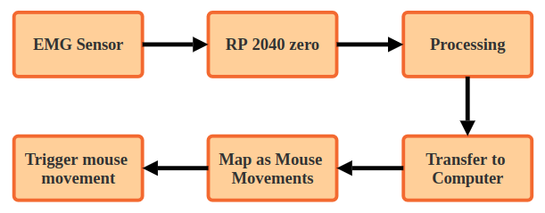
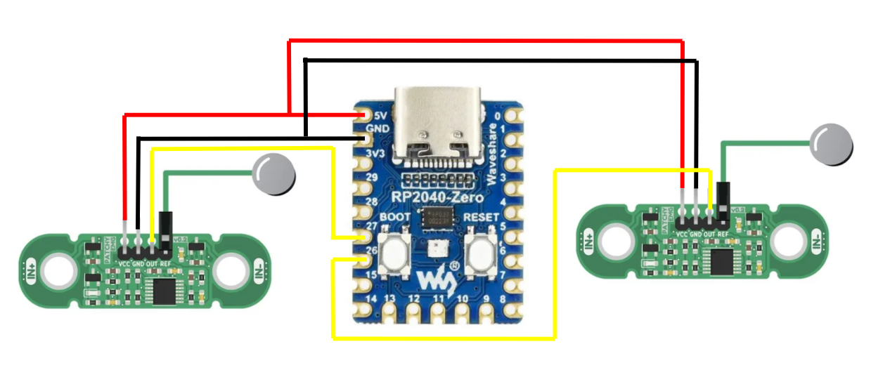
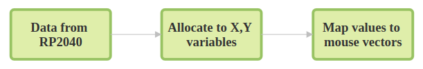
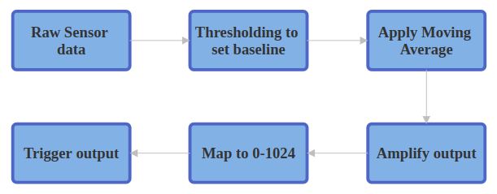
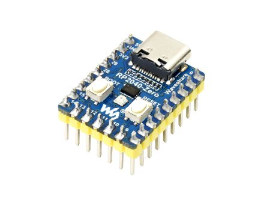
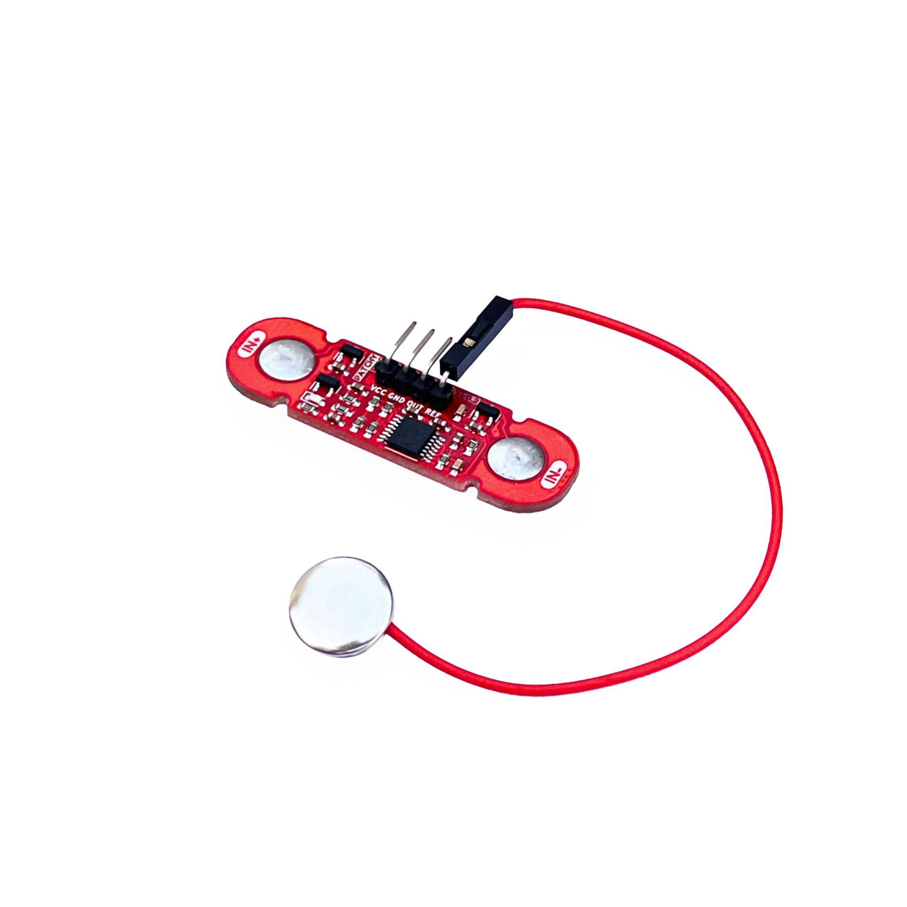
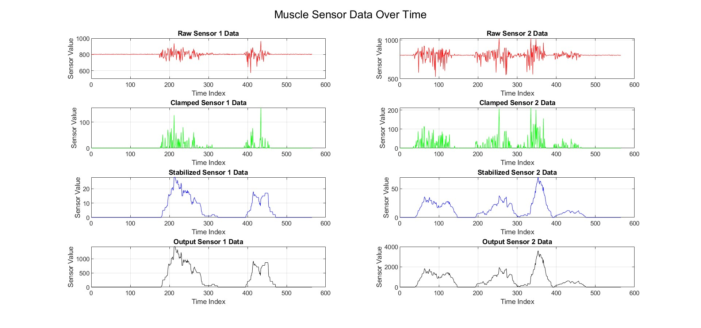
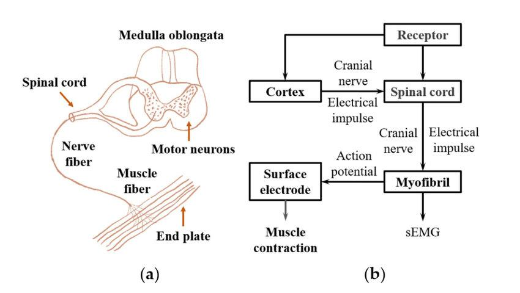
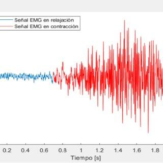

# EMG-Based Assistive Device for Enhanced Human–Computer Interaction

Control a computer mouse with muscle signals — a low-cost, non-invasive
assistive interface built with two EMG sensors and an RP2040 microcontroller.

Signals and Systems — Project Based Learning, Department of ECE, Anurag University.

**Team:** Rujul Rajeev Rumale · G. Sai Vignesh
**Supervisor:** Dr. Raghu Indrakanti, Assistant Professor, Dept. of ECE

This repo recovers and organises the two surviving project documents
(full report + presentation) into runnable firmware, host software,
hardware docs, and figures.

---

## Contents

- [What it does](#what-it-does)
- [System overview](#system-overview)
- [Signal processing](#signal-processing)
- [Repository structure](#repository-structure)
- [Hardware](#hardware)
- [Firmware](#firmware)
- [Host software](#host-software)
- [Setup](#setup)
- [Validation and results](#validation-and-results)
- [Report and presentation](#report-and-presentation)
- [Applications and future work](#applications-and-future-work)
- [References](#references)
- [License](#license)

## What it does

Surface EMG electrodes on the forearm capture muscle activity. The RP2040
filters and smooths the signals, streams them over USB serial, and a Python
program maps them to cursor movement (`pyautogui`):

- Sensor 1 → X axis, Sensor 2 → Y axis
- Deliberate contractions move the cursor; rest = no motion (threshold + deadzone)
- Real-time loop (~20 Hz firmware + ~20 Hz host) for immediate feedback

Intended users: people with limited fine-motor control (e.g. wrist/amputee
impairments) who cannot use touch/mouse effectively. The same pipeline extends
to gaming, assistive robotics, prosthetics, and rehab monitoring.

## System overview



```text
Muscle → BioAmp Patchy ×2 → RP2040-Zero → USB serial "avg1,avg2"
  → Python (serial → map_range → pyautogui.moveRel) → cursor
```

Wiring (two Patchy boards + RP2040-Zero):



Python mapping stage:



## Signal processing



| Stage | Where | Detail |
|---|---|---|
| Band-pass (front end) | BioAmp Patchy | ~72–720 Hz on-board (per presentation) |
| Threshold / baseline clamp | Firmware | `< 800 → 0`, else `v − 800`; removes rest noise |
| Amplitude scaling | Firmware | `map(0..26 → 0..1023)` for full-resolution control |
| Moving average | Firmware | 15-sample circular buffer per channel (~0.75 s @ 50 ms) |
| Range map + deadzone | Host | `0..1023 → −10..10 px`, deadzone ~0.5 px suppresses jitter |
| Smoothing delay | Host | `0.05 s` pacing; tune via `--delay`, `--mmin/--mmax` |

EMG background: 0–10 mV amplitude, dominant energy ~50–150 Hz within 20–500 Hz,
highly noise-sensitive (electrode/skin impedance, motion artefact, mains hum) —
hence threshold + averaging + careful grounding.

## Repository structure

```text
.
├── README.md
├── LICENSE
├── firmware/
│   ├── emg_firmware.ino      # RP2040 firmware (recovered from report Appendix A)
│   └── README.md
├── software/
│   ├── emg_mouse.py          # serial → mouse (recovered from Appendix B, with CLI)
│   ├── log_emg.py            # serial → CSV logger for validation
│   ├── requirements.txt      # pyserial, pyautogui
│   └── README.md
├── hardware/
│   └── README.md             # BOM + wiring table
├── docs/
│   ├── report-summary.md     # chapter-by-chapter summary
│   ├── presentation-outline.md  # 17-slide outline
│   ├── figures/              # curated diagrams, photos, result plots
│   └── originals/            # surviving source docs + PDF exports
│       ├── EMG_Paper_RV_V4.odt / .pdf
│       └── Team_1-presentation.pptx / .pdf
```

## Hardware

Full list: [`hardware/README.md`](hardware/README.md)

- **Waveshare RP2040-Zero** — RP2040 (dual Cortex-M0+ @ 133 MHz), 12-bit ADC,
  USB-C, small/low-power.
- **2× Upside Down Labs Muscle BioAmp Patchy** — wearable surface-EMG,
  snap electrodes + reference lead.




Wiring summary: Patchy `OUT → A0/A1 (GP26/GP27)`, `VCC → 5V`, `GND → GND`,
`REF` to reference electrode. See [`hardware/README.md`](hardware/README.md).

## Firmware

Source: [`firmware/emg_firmware.ino`](firmware/emg_firmware.ino) — faithful
recovery of Appendix A (buffer 15, threshold 800, `map 0..26 → 0..1023`,
`Serial 115200`, `delay(50)`).

Flash with Arduino IDE (RP2040 core, board `Waveshare RP2040 Zero`), verify on
Serial Plotter @ 115200. Details + tuning: [`firmware/README.md`](firmware/README.md).

## Host software

- [`software/emg_mouse.py`](software/emg_mouse.py) — Appendix B logic
  (`serial` read → `map_range(0..1023 → −10..10)` → `pyautogui.moveRel`)
  plus `--port/--baud`, `--deadzone`, `--list-ports`, failsafe handling.
- [`software/log_emg.py`](software/log_emg.py) — logs `t_s,sensor1,sensor2`
  CSV for MATLAB/offline plots.

```bash
pip install -r software/requirements.txt
python software/emg_mouse.py --port /dev/ttyACM0 --baud 115200
# Windows: python software/emg_mouse.py --port COM13 --baud 115200
```

Details: [`software/README.md`](software/README.md).

## Setup

1. **Wire** per [`hardware/README.md`](hardware/README.md) + `docs/figures/wiring-rp2040-two-patchy.png`.
2. **Flash** `firmware/emg_firmware.ino` (Arduino IDE, 115200 baud).
3. **Check** live envelopes in Arduino Serial Plotter.
4. **Install** `pip install -r software/requirements.txt`.
5. **Run** `python software/emg_mouse.py --port <PORT>`; start with small
   `--mmin/--mmax` (±5) and adjust threshold/deadzone until rest = still,
   flex = smooth motion.
6. **Log** `python software/log_emg.py --port <PORT> --out emg_log.csv`
   for validation plots.

Linux: user must be in `dialout` group; `pyautogui` may need `xdotool`/X11 deps.
Keep a keyboard free for `Ctrl+C`; screen corners trigger pyautogui failsafe.

## Validation and results

Per report Ch. VI + slide 13, validated in three stages:

1. Arduino Serial Plotter — live signal envelope check.
2. Python `serial` → CSV (`software/log_emg.py`).
3. MATLAB plot of CSV + `pyautogui` cursor tasks (move/select/click).

Result plot (raw → clamped → stabilized → output, 2 channels):



Reported outcome: reliable EMG→mouse control with good responsiveness;
accuracy improvable with better filters (boxcar/Gaussian), per-user
sensitivity, and effortless mapping (no hard contraction).

EMG reference figures from the report:




## Report and presentation

- Full report (33 pp): `docs/originals/EMG_Paper_RV_V4.odt` / `.pdf` —
  summary in [`docs/report-summary.md`](docs/report-summary.md).
- Slides (17): `docs/originals/Team_1-presentation.pptx` / `.pdf` —
  outline in [`docs/presentation-outline.md`](docs/presentation-outline.md).

## Applications and future work

**Now:** hands-free computer access, gaming input, assistive-robot /
prosthetic control demos, rehab muscle monitoring.

**Next (per report Ch. VIII + slide 15):** more channels for multi-DOF control;
leaner/faster DSP; boxcar/Gaussian smoothing comparison; on-device adjustable
sensitivity; calibration-free mapping; ML (SVM/ANN) gesture classification;
mobile (Bluetooth) + wheelchair/exoskeleton integration.

## References

1. Barreto et al. (2007) — Real-Time Assistive Computer Interface for Users with Motor Disabilities.
2. Lin et al. (2008) — Pattern Classification of Surface EMG Signals Using SVM. DOI: 10.1109/ROBIO.2008.4633672.
3. Chauvin & Moreau (2008) — EMG-Based Multichannel Human-Computer Interface. DOI: 10.1109/ISP.2008.4428465.
4. Akben & Temurtas (2018) — EMG Signal Classification for HCI Using ANN.
5. Rojas-Martinez & Alvarez (2018) — Survey on EMG Pattern Recognition for Human-Machine Interface. Sensors 18(8), 2483.

## License

MIT — see [LICENSE](LICENSE). Coursework prototype, not a medical device.

---


